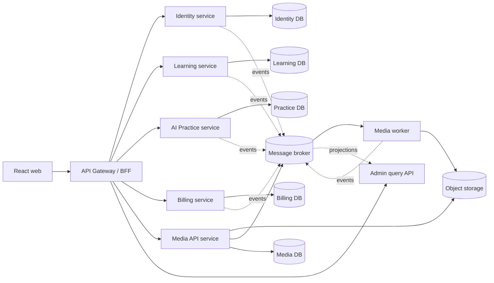

# Kiến trúc microservice cho HihiEnglish

Trạng thái: **Đã chấp thuận làm kiến trúc đích**  
Ngày: 2026-09-12

## Quyết định

HihiEnglish sẽ chuyển từ NestJS monolith sang microservices theo từng bước (strangler pattern), không tách toàn bộ hệ thống trong một lần.

Trong suốt quá trình chuyển đổi:

- Frontend tiếp tục gọi một địa chỉ `/api`; API Gateway/BFF chịu trách nhiệm định tuyến.
- Mỗi service sở hữu dữ liệu của chính nó. Service khác chỉ tham chiếu bằng ID, không join hoặc ghi trực tiếp vào bảng của service sở hữu.
- HTTP dùng cho truy vấn đồng bộ cần kết quả ngay; event bất đồng bộ dùng cho thay đổi trạng thái liên miền.
- Mỗi event phải có `eventId`, `occurredAt`, `version`, `correlationId` và payload có version.
- Event được phát qua transactional outbox để tránh tình trạng cập nhật database thành công nhưng publish event thất bại.
- Việc tách database vật lý chỉ diễn ra sau khi code không còn truy cập chéo bảng.

Nest hỗ trợ cả request-response và event-based messaging qua `ClientProxy`; monorepo mode phù hợp để nhiều application và library dùng chung tooling trong giai đoạn chuyển đổi.

## Hiện trạng và các điểm ghép nối

Ứng dụng hiện là một NestJS process duy nhất:

- `src/app.module.ts` nạp tất cả module nghiệp vụ.
- `src/prisma/prisma.module.ts` khai báo `PrismaModule` là global nên mọi module có thể truy cập mọi bảng.
- `prisma/schema.prisma` đặt toàn bộ model và quan hệ trong một schema PostgreSQL.
- `src/main.ts` đồng thời phục vụ API, WebSocket, static frontend và thư mục media cục bộ.
- `src/video-translate/video-translate.service.ts` xử lý job dài bằng fire-and-forget trong process HTTP. Job có thể bị bỏ dở khi deploy/restart và không thể scale độc lập an toàn.
- `src/payments/payments.service.ts` cập nhật order và trạng thái premium của `User` trong cùng một transaction. Đây là distributed transaction tiềm ẩn khi tách Billing khỏi Identity.
- `src/admin/*` đọc dữ liệu của hầu hết domain nên Admin phải là BFF/read model, không phải service sở hữu dữ liệu.

Điểm chặn đầu tiên của việc tách `video-translate` là file đang nằm trong `storage/` của local filesystem. API và worker ở hai instance khác nhau sẽ không dùng chung file. Cần chuyển source/output sang object storage trước khi chạy worker độc lập.

## Kiến trúc đích

Ban đầu các database logic có thể là các PostgreSQL schema riêng trong cùng một cluster. Mục tiêu cuối là credential/schema riêng cho từng service; không bắt buộc mỗi service phải có một server PostgreSQL riêng.

## Ranh giới service và quyền sở hữu dữ liệu

| Service | Trách nhiệm | Model sở hữu |
| --- | --- | --- |
| `identity-service` | đăng ký, đăng nhập, Google OAuth, reset password, hồ sơ, guest identity, JWT/JWKS | `User`, `PasswordReset` |
| `billing-service` | package, payment order, webhook SePay, subscription/entitlement | `Package`, `PaymentOrder`, `PaymentTransaction`, model `Subscription` mới |
| `learning-service` | catalog, lesson, transcript, lesson access, lịch sử và yêu thích, vocabulary/SRS | `Category`, `Lesson`, `Transcript`, `LessonAccess`, `UserLessonHistory`, `UserFavorite`, `CategoryFavorite`, toàn bộ `Vocabulary*` |
| `practice-service` | chat, shadowing WebSocket, speaking session, scoring và quota nói | `ChatConversation`, `ChatMessage`, toàn bộ `Speaking*` |
| `media-service` + `media-worker` | nhận upload, tạo job, dịch/lồng tiếng video, quản lý asset và quota | `VideoTranslateJob`, `VideoTranslateDailyUsage` |
| `admin-query` | dashboard tổng hợp, không sở hữu dữ liệu nguồn | projection/read model riêng |
| `api-gateway` | TLS edge, CORS, auth context, routing, rate limit, response composition | không có database nghiệp vụ |

`userId`, `lessonId`, `packageId` ở ngoài service sở hữu chỉ là opaque ID. Không tạo foreign key xuyên database.

### Điều chỉnh model bắt buộc

Các field `isPremium`, `premiumExpiresAt`, `packageId` hiện nằm trong `User` phải chuyển dần sang `Subscription` do Billing sở hữu. Trong giai đoạn tương thích, Identity có thể giữ bản sao read-only `entitlementSnapshot`; Billing là source of truth và phát `billing.entitlement.changed.v1`.

Admin không được query trực tiếp tất cả database ở trạng thái đích. Nó consume event để dựng projection; các thao tác ghi của admin gọi đúng owner service.

## Giao tiếp giữa các service

### Đồng bộ

- Client chỉ gọi Gateway bằng REST/WebSocket.
- Gateway chuyển tiếp access token; mỗi service tự verify JWT bằng public key/JWKS, không gọi Identity cho mỗi request.
- Chỉ dùng request-response nội bộ khi người dùng cần kết quả ngay, với timeout, retry có giới hạn và circuit breaker.
- Không tạo chuỗi gọi đồng bộ dài hơn hai service trong một request.

### Bất đồng bộ

Các event nền tảng:

- `identity.user.created.v1`
- `identity.user.updated.v1`
- `billing.payment.completed.v1`
- `billing.entitlement.changed.v1`
- `learning.lesson.progressed.v1`
- `practice.session.completed.v1`
- `media.job.requested.v1`
- `media.job.completed.v1`
- `media.job.failed.v1`

Consumer phải idempotent bằng `eventId`. Webhook SePay tiếp tục idempotent theo `sepayTransactionId`. Không dùng event để trả lời trực tiếp một HTTP request.

## Thứ tự chuyển đổi

### Giai đoạn 0 — Cố định ranh giới trong monolith

1. Thay `PrismaModule` global bằng repository/port thuộc từng domain.
2. Cấm service truy cập model do domain khác sở hữu.
3. Tách DTO/event contract vào library chỉ chứa type và schema validation; không chia sẻ service/repository implementation.
4. Bổ sung correlation ID, structured logging, readiness/liveness và tracing.
5. Dừng chạy `prisma db push` tự động khi production khởi động; dùng migration deployment riêng.

Tiêu chí hoàn tất: dependency test xác nhận không có import hoặc Prisma access xuyên domain ngoài các port được khai báo.

### Giai đoạn 1 — Tách Media worker trước

1. Chuyển file upload, thumbnail và dubbed audio từ `storage/` sang S3-compatible object storage/Cloudinary.
2. API chỉ validate, reserve quota, tạo `PENDING` job và publish `media.job.requested.v1` qua outbox.
3. Worker claim job, heartbeat lease, retry có backoff, ghi kết quả và publish completed/failed event.
4. Thêm dead-letter handling và nút retry cho admin.
5. Chạy worker thành deployment độc lập; API contract hiện tại không đổi.

Tiêu chí hoàn tất: restart API hoặc worker không làm mất job; hai worker không xử lý trùng cùng một job; media không phụ thuộc local disk.

### Giai đoạn 2 — Tách Billing

1. Tạo `Subscription` và backfill từ các field premium trong `User`.
2. Webhook hoàn tất payment và subscription trong Billing transaction.
3. Publish entitlement event qua outbox; các service giữ local entitlement projection để kiểm quota.
4. Chuyển route `/packages`, `/payments` và phần ghi tương ứng của admin sang Billing.

Tiêu chí hoàn tất: Billing không đọc/ghi bảng `users`; payment retry không cấp premium hai lần.

### Giai đoạn 3 — Tách Practice

Tách chat, shadowing và speaking cùng nhau vì dùng chung AI/audio concern. Quota dựa trên entitlement projection cục bộ; scoring nền chạy qua queue thay vì Promise trong memory.

### Giai đoạn 4 — Tách Learning và Admin read model

Tách catalog/progress/vocabulary sau cùng. Dựng admin projection từ event, sau đó bỏ các truy vấn cross-domain trong `src/admin/*`.

## Route mapping trong giai đoạn chuyển đổi

Gateway giữ nguyên public route để frontend không cần đổi đồng loạt:

| Prefix hiện tại | Owner đích |
| --- | --- |
| `/api/auth`, `/api/users` | Identity |
| `/api/packages`, `/api/payments` | Billing |
| `/api/categories`, `/api/lessons`, `/api/vocabulary` | Learning |
| `/api/chat`, `/api/speaking`, Shadowing WebSocket | Practice |
| `/api/video-translate`, `/media/*` | Media |
| `/api/admin` | Admin BFF, sau đó Admin query API |

Mỗi prefix được chuyển độc lập bằng feature flag/routing config. Có thể rollback một route về monolith mà không rollback service khác.

## Quy tắc triển khai

- Mỗi service có health, readiness và graceful shutdown riêng.
- Mỗi service có database credential riêng, chỉ có quyền trên schema/bảng mình sở hữu.
- Migration chạy như release job; service startup không tự thay schema.
- Không ghi secret vào image hoặc contract/event payload.
- Media worker có concurrency giới hạn theo CPU và quota của nhà cung cấp AI.
- Gateway không chứa business logic; composition chỉ dành cho response/UI.
- Deploy canary từng route và so sánh response trước khi chuyển toàn bộ traffic.

## Những việc chưa làm ở quyết định này

Tài liệu này cố ý chưa tạo các process microservice giả dùng chung local disk/database không kiểm soát. Bước code đầu tiên là externalize media storage và tạo durable job/outbox; sau đó mới tách `media-worker` thành deployment độc lập.

## Tài liệu tham khảo

- [NestJS Microservices](https://docs.nestjs.com/microservices/basics)
- [NestJS CLI monorepo](https://docs.nestjs.com/cli/monorepo)
- [Prisma: multiple database schemas](https://docs.prisma.io/docs/orm/prisma-schema/data-model/multi-schema)

